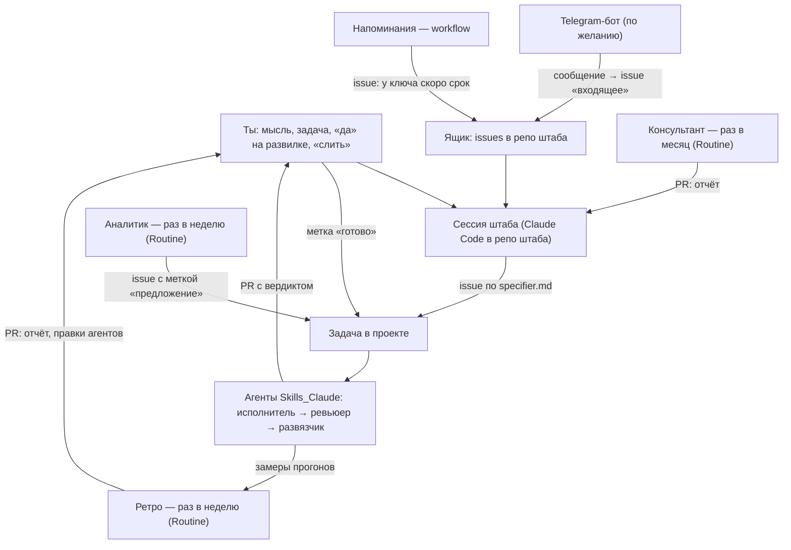

# Гайд штаба: свой штаб вокруг агентов

Агенты из [гайда агентов](гайд-агентов.md) делают одно: задача с меткой `готово` → PR. Вокруг них у нас живёт **штаб** — закрытый репо процесса и сессия Claude Code, которая его ведёт: ставит задачи, разбирает прогоны, помнит решения, раз в неделю сама смотрит, что пошло не так. Здесь — что это такое, из чего состоит и промпт, с которым Claude Code соберёт такой же под тебя. Образец — [`templates/shtab/`](../templates/shtab/).

> **Честно о готовности.** Наш штаб работает каждый день. Пример — его копия без наших проектов и решений, и целиком на чужом аккаунте его никто не собирал: ты — первый. Если шаг идёт не так, как написано, — разбирайся с Claude Code и напиши нам: поправим гайд и пример.

Слова, которые встретятся:

- **Сессия** — одна беседа с Claude Code. Облачная — в claude.ai/code: идёт с телефона или компьютера, без своего компьютера рядом.
- **Routine** — задание по расписанию в claude.ai/code: в нужный час оно будит сессию Claude и даёт ей сообщение («прочитай промпт ретро и выполни»).
- **Хост** — постоянная сессия, которую Routine будит раз за разом: репо к ней подключены один раз, прошлые запуски она помнит.
- **Субагент** — помощник, которого Claude запускает внутри сессии со своим чистым контекстом; возвращает только вывод. Нужен, чтобы тяжёлое чтение не забивало беседу.

## Зачем штаб, если агенты и так работают

Без штаба конвейер работает полностью: ты пишешь задачу, ставишь `готово`, сливаешь PR. Штаб нужен, когда проектов несколько и хочется, чтобы:

- задачи писались хорошо — так, что агент делает их без вопросов (сессия пишет их по `agents/specifier.md`);
- решения не терялись — через месяц понятно, почему сделано так (`05-Решения.md`);
- каждая новая сессия знала, где мы сейчас, а не начинала с нуля (`04-Журнал.md`, «Открыто», передача);
- ошибки агентов не повторялись — раз в неделю кто-то разбирает прогоны и правит инструкции (ретро);
- было видно, сколько уходит подписки, и пачка задач не съедала окно целиком (учёт расхода).

## Из чего состоит



| Часть | Что делает | Где в примере | Нужно ли |
|---|---|---|---|
| Сессия штаба | ведёт документы, превращает просьбы в задачи, разбирает отчёты, говорит, когда сливать | `CLAUDE.md`, `docs/01…06` | основа |
| Документы | замысел, архитектура, план, журнал с «Открыто», решения, процесс | `docs/` | основа |
| Каталог проектов | карточка на проект: статус, связи, кого смотрит аналитик; скрипт отвечает на «какие проекты активны» | `docs/проекты/`, `scripts/projects.py` | с 3–4 проектов |
| Ящик | issues с меткой `входящее` в репо штаба: мысль на бегу, сессия разберёт | метка + `CLAUDE.md` | по желанию |
| Ретро | раз в неделю: сводка прогонов, ошибки первыми, правки инструкций агентов PR-ом; правку проверяет субагент-критик | `docs/ретро/промпт.md`, `scripts/summary.py` | после первых 5–10 прогонов |
| Аналитик | раз в неделю: читает планы и журналы проектов, предлагает до 10 задач меткой `предложение`; твоё `готово` — согласие | `docs/аналитик/промпт.md` | когда задачи кончаются быстрее идей |
| Консультант | раз в месяц: проекты и процесс целиком — новые проекты, связи, что упростить; до 5 предложений, каждое через критика | `docs/консультант/промпт.md` | когда проектов несколько |
| Учёт расхода | каждый прогон пишет «Замер прогона» (ходы, минуты, $); таблица «Прикидка пачки» переводит $ в % окна и недели подписки | `docs/06-Процесс.md` | сразу |
| Напоминания | раз в неделю — задача, если у ключа в `токены.md` скоро срок | `scripts/reminders.py`, workflow | сразу, дёшево |
| Telegram-бот | сообщение своему боту → задача в ящике; ответ «#N принято» | `channels/telegram/` | последним |

Чего в примере нет: наш аварийный план (что делать, если пропал аккаунт или устройство) и портфолио. Идея одной строкой: заведи `docs/07-Аварийный план.md` — что от чего зависит и как восстановить — когда штаб начнёт тебе реально помогать.

### Как части связаны с агентами

- Агенты про штаб **не знают**: они читают только задачу и `CLAUDE.md` проекта. Штаб пишет задачи и правит агентов PR-ами в твой форк `Skills_Claude` — как любой человек.
- Ретро и сводка опираются на то, что пишут агенты: аннотацию «Замер прогона», комментарии ревьюера, ветки `agent/<номер>`. Поменяешь это в своём форке — поправь `scripts/summary.py`.
- Ретро, аналитик и консультант **предлагают**, решаешь ты: их работа — PR и issues, ничего не сливают и меток `готово` не ставят.

### Сколько стоит

Всё работает от твоей подписки Claude: сессия штаба, Routine и агенты тратят одно и то же окно (5 часов) и неделю. Наши числа на нашей подписке: запуск ретро ≈ 5 $ — ≈ 14 % окна и ≈ 2 % недели, консультант ≈ 6 $ — ≈ 19 % окна и ≈ 2 % недели; час сессии штаба ≈ 0,7 % недели. Поэтому Routine ставь на время, когда сам не работаешь. Свои числа узнаешь по первым неделям — ретро считает их само.

## Собрать с Claude Code

Нужно: подписка Claude, аккаунт GitHub, агенты уже подключены хотя бы к одному проекту ([гайд агентов](гайд-агентов.md)). Удобнее всего — в облаке, claude.ai/code: там же потом будут жить Routine.

1. Создай на GitHub **закрытый** репо для штаба (например, `hq`) — пустой, с README. Это делаешь ты: так ты точно знаешь, что он закрытый.
2. Открой claude.ai/code, новую сессию на этом репо, и вставь, заполнив `<…>`:

```
Собери мне штаб по гайду
https://github.com/goigolden88/Skills_Claude/blob/main/docs/гайд-штаба.md
и примеру templates/shtab/ из моего форка <логин>/Skills_Claude.
Прочитай гайд и пример целиком. Пример — образец, а не продукт:
подгони под меня, лишнее не тащи.

Спроси у меня только то, без чего не собрать, по одному вопросу:
мой логин GitHub, часовой пояс, язык; список моих проектов (репо и
одна фраза о каждом); какие репо с личными данными трогать нельзя;
мой опыт в разработке; какие части брать сейчас (ретро, аналитик,
консультант, напоминания, Telegram-бот).

Затем:
- перенеси пример в этот репо, подставь <…>, заведи карточки проектов
  (scripts/projects.py --new), проверь: projects.py --check — код 0;
- заполни 01-Проект и 03-План по моим ответам, первую запись Журнала
  и первое решение — что собрали и почему;
- покажи мне итог списком файлов и жди «да» до коммита.

Routine для ретро, аналитика и консультанта — только после того, как
агенты сделают хотя бы несколько PR; сейчас запиши это в План.
Ключи и пароли у меня не проси и в беседу не выводи.
```

3. Когда соберётся — с ней же, по одному:
   - **Напоминания:** впиши в `docs/токены.md` сроки своих ключей; workflow заработает сам по расписанию (проба — Actions → «Напоминания» → «Run workflow»).
   - **Ретро** (после первых прогонов агентов): попроси сессию «заведи хост и Routine ретро по docs/ретро/промпт.md: четверг, <час>». Хост — отдельная сессия: репо к ней подключает только твоё слово в самом хосте, поэтому один раз зайди в неё и скажи «подключи репо из списка промпта». Аналитик — так же, консультант — с одноразовой Routine (почему — в начале его промпта).
   - **Telegram-бот** — последним: `channels/telegram/README.md`, девять шагов; нужен бесплатный аккаунт Cloudflare. Ключи бота, Cloudflare и GitHub вписываешь ты, в их панели, — не в беседу.

## Если застрял

Покажи Claude Code шаг, ошибку или вывод скрипта — и спроси, что не так. Скрипты примера говорят по-русски, что им не хватает: `projects.py --check` — изъяны каталога, `start.sh` — «Требует внимания», `reminders.py` с `DRY_RUN=1` — что бы он открыл. Не помогло — напиши нам: что делал, на каком шаге, что ответила программа.
